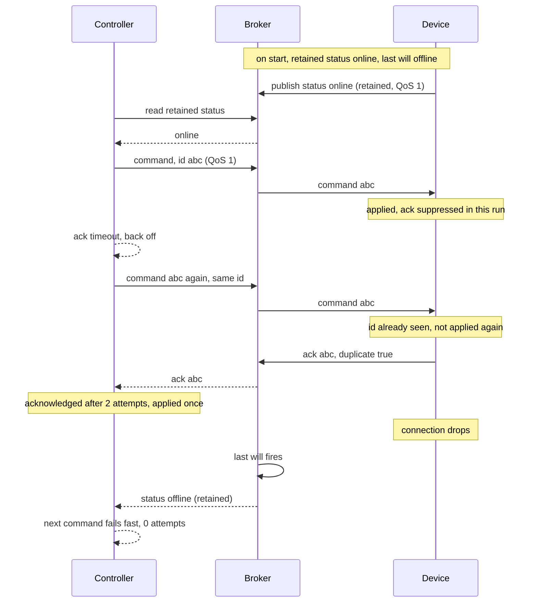

# device-control-demo

A small Python service that sends commands to simulated devices over MQTT and tells you
what actually happened to each command: it was acknowledged, it timed out, or the device
is offline.

The point of the project is the delivery semantics, not the devices. The devices are
simulated, and they can be told to misbehave, drop acks, delay acks, vanish without a
clean disconnect, so the controller's failure paths are exercised by real tests rather
than described in prose.

## What it does

Three topics per device, all under `devices/<device_id>/`:

| Topic | Direction | Contents |
| --- | --- | --- |
| `cmd` | controller to device | one JSON command: `command_id`, `action`, `params` |
| `ack` | device to controller | the `command_id` it answers, `result`, the device `state`, a `duplicate` flag |
| `status` | device to broker | `{"device_id": ..., "online": true/false}`, published retained |

Actions are `arm`, `disarm`, and `set_mode` with a `mode` of `home`, `away`, or `night`.

**Commands and acks.** The controller publishes a command with a fresh `command_id` and
waits for the ack carrying that same id.

**Retries.** On silence it republishes the *same* command id after an exponential backoff
(`backoff_base * backoff_factor ** (attempt - 1)`, capped at `backoff_max`), up to
`max_attempts`. Every send ends in exactly one of three statuses:

- `acknowledged`: the device answered. The ack itself says whether it `applied` or
  `rejected` the command, so an acknowledged rejection is still a successful round trip.
- `timed_out`: the device was online but no ack arrived within the attempt budget.
- `device_offline`: the broker's retained status says the device is not connected, or it
  dropped off while the command was in flight. Nothing further is attempted.

**Idempotency.** The device remembers the command ids it has seen (a bounded history, 256
by default). A repeat id is never applied a second time: the stored ack is replayed with
`duplicate: true`. So a retry caused by a lost ack cannot arm a device twice.

**Presence.** Each device publishes a retained `online` status on connect and registers an
`offline` status as its MQTT last will. A controller subscribing to `devices/+/status`
therefore learns the state of every device that has ever connected, immediately, and the
broker marks a device offline on its behalf when the connection drops. A device id with no
retained status at all has never connected, and is reported the same way as offline.

**Late acks.** An ack that arrives after the controller has given up is recorded on
`controller.late_acks` and otherwise ignored. It does not retroactively turn a `timed_out`
result into a success.

## How a command flows



## Delivery guarantees

| Property | Holds? | How |
|---|---|---|
| Command reaches the device | at least once | QoS 1 to the broker, plus the controller's own retry with exponential backoff until an ack arrives or attempts run out |
| Ack reaches the controller | at least once | QoS 1. A duplicate ack is matched on command id and ignored |
| Command applied on the device | **effectively once, while the device stays up** | the device keeps a bounded history of command ids and replays the stored ack instead of applying again |
| Command applied across a device restart | **no** | that history is in memory. A restart loses it, and a replayed command is applied a second time |
| Ordering between commands | not guaranteed | each command is matched on its own id, never on arrival order, so a late or stray ack cannot complete a different command |
| Presence | eventually correct | a retained status topic plus a last will, so a controller that connects later still learns the current state |

Two choices worth explaining:

**QoS 1, not QoS 2.** QoS 2 would give exactly once delivery at the cost of a four
step handshake per message. It is not needed here because the device already
deduplicates on command id, which is the property that actually matters: receiving a
command twice is harmless, applying it twice is not. QoS 1 plus application level
deduplication is cheaper and covers the controller's own retries, which QoS 2 would
not, since those are separate messages with the same id.

**The dedupe window is bounded.** A long lived device cannot keep every command id it
has ever seen, so the history has a fixed size and the oldest ids fall out. A replay
older than the window is applied again. Tested in
`tests/test_delivery_guarantees.py`.

## Layout

```
src/device_control/protocol.py    topics, message encode/decode
src/device_control/transport.py   the MQTT surface used here, plus the paho implementation
src/device_control/device.py      command handling, state, fault injection, the MQTT runner
src/device_control/controller.py  send, wait, retry, presence, final status
src/device_control/cli.py         device-sim and device-send
scripts/load_check.py             many devices, round trip latency
tests/fake_broker.py              in-process broker for the unit tests
```

The controller and the device talk to a `Transport`, not to paho directly. That is what
lets the same code run against an in-process fake broker in the unit tests and against
real MQTT in the integration tests.

## How to run it

Python 3.11, and Docker for the broker.

```bash
python3.11 -m venv .venv
.venv/bin/python -m pip install -e ".[dev]"
docker compose up -d          # Mosquitto on localhost:1883
```

Run a device in one shell:

```bash
.venv/bin/device-sim dev-1
```

Send it a command from another:

```bash
.venv/bin/device-send dev-1 arm
```

```json
{
  "ack_detail": "",
  "attempts": 1,
  "command_id": "74f630f9eb1c40948f75302058d110d2",
  "detail": "",
  "device_id": "dev-1",
  "duplicate_ack": false,
  "elapsed_ms": 4.6,
  "result": "applied",
  "state": {
    "armed": true,
    "mode": "home"
  },
  "status": "acknowledged"
}
```

`set_mode` takes the mode as a flag:

```bash
.venv/bin/device-send dev-1 set_mode --mode away
```

The exit code is 0 only when the device acknowledged *and* applied the command, so a
rejection, a timeout, and an offline device all exit 1.

To watch the failure paths, start the device with a fault and send to it:

```bash
.venv/bin/device-sim dev-2 --drop-acks 1        # first ack vanishes; the retry is answered
.venv/bin/device-sim dev-3 --drop-acks 99       # nothing is ever answered; timed_out
.venv/bin/device-sim dev-4 --ack-delay 5        # ack arrives after the controller gave up
.venv/bin/device-sim dev-5 --offline-after 10   # drops the connection; the last will fires
```

### One command demo

```bash
docker compose up -d
python scripts/demo.py
```

Prints the whole story against a real broker: the device announcing itself with a
retained status, a command that needs two retries because its acks are suppressed,
the device applying it exactly once anyway, a drop where the last will marks it
offline and the next command fails fast without burning retries, then the device
coming back and answering first time with its state intact.

Or entirely in Docker:

```bash
docker compose run --rm demo
```

### Tests

```bash
.venv/bin/python -m pytest
```

75 tests. The unit tests use the in-process fake broker and need no Docker. The
integration tests need a real broker and **skip** when none is reachable; set
`REQUIRE_MQTT=1` to make a missing broker a failure instead, which is what CI does.
No `.env` and no secrets are involved either way.

```bash
docker compose up -d
REQUIRE_MQTT=1 .venv/bin/python -m pytest
```

That is the number from a real run with the broker up, so every integration test
actually executed rather than skipping.

### Lint

```bash
.venv/bin/python -m pip install ruff==0.16.10
.venv/bin/ruff check .
.venv/bin/ruff format --check .
```

0.16.10 is the version pinned in `.github/workflows/ci.yml` and in the `dev` extra.

### Load check

```bash
.venv/bin/python scripts/load_check.py --devices 100 --commands-per-device 10
```

## Measured results

From one run on this machine, reported exactly as measured. **This is a single laptop with
a local broker** - an Apple M5 (10 cores), macOS 26.6.2, Python 3.11.14 (arm64),
paho-mqtt 2.1.0, and Mosquitto 2.1.2 in Docker on `localhost`. Both ends of every hop are
the same machine, so these numbers say nothing about a real network.

```
devices connected             100
device connect time           0.06 s
commands sent                 1000 (one in flight at a time)
commands acknowledged         1000
commands needing a retry      0
wall time                     0.32 s
commands per second           3167.1
round trip latency, publish to ack
  min                         0.22 ms
  p50                         0.3 ms
  p95                         0.36 ms
  p99                         0.41 ms
  max                         0.53 ms
```

**P50 0.30 ms, P95 0.36 ms** over 1000 commands to 100 connected devices, with no command
needing a retry. Repeating the run gave P50 0.30 to 0.33 ms and P95 0.35 to 0.55 ms; a run
immediately after process start was the slowest of those.

Read that with the measurement's shape in mind:

- One command is in flight at a time, so this is round trip latency under a connected
  fleet, not a throughput ceiling. The `commands per second` figure is a consequence of
  the latency and the sequential loop, not a measured capacity limit.
- All 100 devices run as threads in one process, each with its own MQTT connection. They
  are connections and subscriptions on the broker, but not 100 separate processes or hosts.
- Percentiles are nearest-rank over the 1000 acknowledged commands.
- The fleet was idle apart from the commands being measured. There is no background
  telemetry.

## Limits

- **Simulated devices only.** `SimulatedDevice` is a few flags and a dict. No real
  hardware, no firmware, no physical actuation, no device SDK.
- **One local broker.** No clustering, no failover, no bridging, no broker persistence
  (the dev config sets `persistence false`, so retained statuses are lost on restart).
- **The bundled broker has no TLS and no auth.** It runs with `allow_anonymous true`
  on a plain listener, so any client on the host can read every topic and command any
  device. The config says so in a comment; do not expose it. The *client* does support
  both: pass `username`, `password` and a `TlsConfig` to `PahoTransport`, or set
  `MQTT_USERNAME`, `MQTT_PASSWORD` and `MQTT_TLS` in the environment. Both are off
  unless asked for, certificate verification is on whenever TLS is, and
  `MQTT_TLS_INSECURE` exists only for a self signed broker on a developer machine.
  None of that has been exercised against a broker that actually requires it, only
  that the configuration reaches paho.
- **No authorization model.** Nothing distinguishes one controller from another. There are
  no device identities beyond a topic segment, no signing, and no replay protection beyond
  the idempotency history.
- **Idempotency is in memory and bounded.** The 256-entry history is per process. A device
  restart, or more than 256 intervening commands, and a replayed id is applied again.
  Both cases are asserted in `tests/test_delivery_guarantees.py` rather than left as
  a claim.
- **QoS is not tuned.** Everything is published at QoS 1, which is at-least-once; the
  idempotency history is what makes that safe, not the QoS level.
- **Presence has the lag the broker gives it.** A dropped device is reported offline when
  the broker fires the last will, which depends on the MQTT keepalive (15 s here), not
  instantly.
- **The controller sends one command at a time per call.** `send` blocks. There is no
  batching, no fan-out helper, and no scheduler.
- **No persistence, metrics, tracing, or admin interface.** No stored command history, no
  dashboards, no alerting.
- **Not a production device platform.** It is a demonstration of command delivery
  semantics: ack matching, bounded retries, idempotency, and presence, and nothing else.
